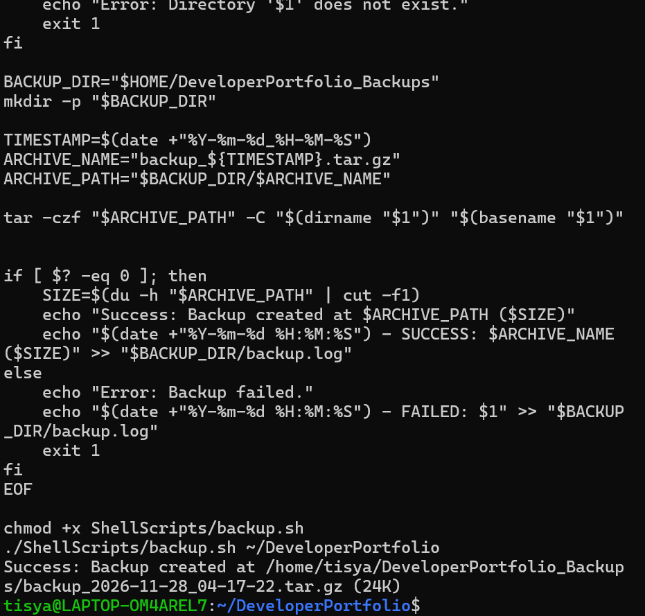

# DeveloperPortfolio — Semester 1 Capstone Project

**Student Name:** Tisya Yadav  
**Roll Number:** 2601730474  
**Program:** B.Tech in Computer Science and Engineering (AI & ML), Section G  
**University:** K.R. Mangalam University  

* **GitHub:** [github.com/tisyayadav62968-sys](https://github.com/tisyayadav62968-sys)  
* **LinkedIn:** [linkedin.com/in/tisya-yadav-897b43436](https://www.linkedin.com/in/tisya-yadav-897b43436/)  

---

## Project Overview
This repository showcases Semester 1 practical skills in Linux system profiling, Bash shell scripting, REST API integration (`curl` & `jq`), Git version control, and developer branding.

## Repository Structure
* `Linux/` — System hardware/OS specs (`system_info.md`) and core command outputs (`commands_output.txt`)
* `ShellScripts/` — Diagnostic report generator (`sysinfo.sh`, `sysinfo.txt`) and timestamped `.tar.gz` backup script (`backup.sh`)
* `APIs/` — GitHub REST API data (`github_user.json`, `github_repos.json`), automated parser (`fetch_data.sh`), and report (`api_report.md`)
* `Screenshots/` — Execution and profile proofs (`backup_demo.png`, `github_profile.png`, `linkedin_profile.png`)

## Execution & Profile Verification

### Backup Script Execution

### GitHub & LinkedIn Profiles
| GitHub Profile | LinkedIn Profile |
| :---: | :---: |
|  |  |
